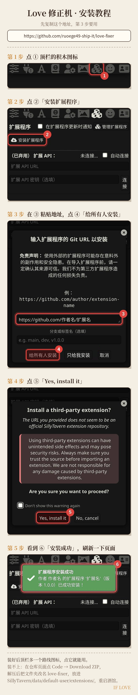

# Love 修正机 · if love

给酒馆（SillyTavern）新手的总体修正扩展：**装上就带你配好酒馆，出了问题帮你查，看不懂的点哪讲哪。**

- **新手引导**：从配置 API 开始，九步带你用红框一步步做完
- **帮我查问题**：自动体检 → 让小助手看屏幕 → 帮你写好提问去答疑
- **优化设置**：手机、电脑各有一键方案，改过的都能还原
- **讲解 / 词典 / 带我学**：点哪讲哪；黑话和功能介绍；边框边教的小课
- **快捷台、大总结**：选卡、切聊天、换头像字体；超过 10 万 token 提醒并带你做大总结

外观和「智库」同一套旅馆票卡风格，支持日间 / 夜间 / 跟随酒馆。

## 安装

酒馆 → 扩展（顶栏积木图标）→ 安装扩展程序 → 粘贴下面的地址 → 给所有人安装：

```
https://github.com/ruoege49-ship-it/love-fixer
```

带截图的步骤看 **[安装教程](docs/install.md)**，或者直接看这张图：



## 用法

装好后顶栏会多一个**路线图标**，所有功能都在里面；第一次打开会自动开始新手引导。

每个功能怎么用：看 **[功能介绍](docs/features.md)**。

## 注意

- 扩展版和酒馆助手脚本版（Love修正机.json）**只开一个**。
- 停用扩展后刷新一次页面，修正才会完全撤掉。
- 配置向导只判断酒馆密钥框是否已填，不保存这处的密钥。小助手单独填写的密钥保存在本机浏览器，并用于请求你选定的接口。
- 开启「输入框草稿防丢」后，未发送的文字会保存在本机浏览器。

## 文件

| 文件 | 说明 |
|---|---|
| `manifest.json` | 扩展说明 |
| `index.js` | 主程序 |
| `style.css` | 外观 |
| `img/` | 修正机里图文教程用的图片 |
| `docs/` | 安装教程和功能介绍 |
| `CHANGELOG.md` | 更新日志 |

作者：if love
