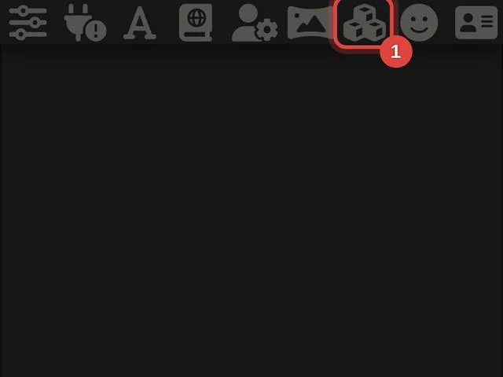
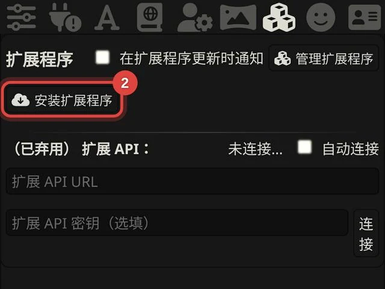
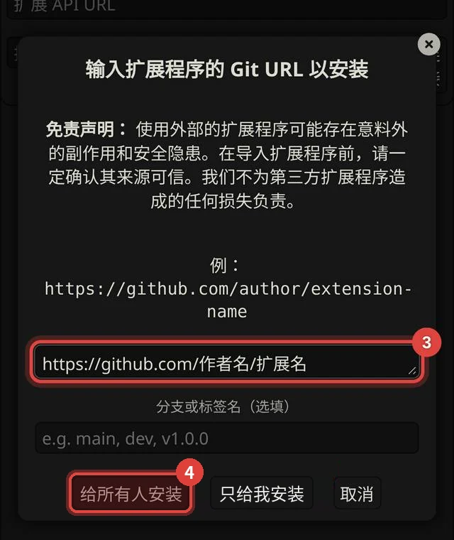
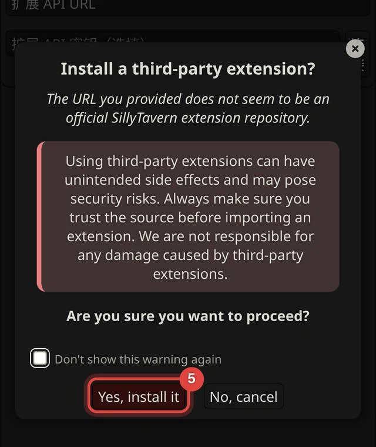
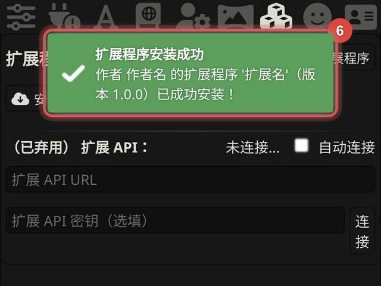

# 安装教程

先复制地址：

```
https://github.com/ruoege49-ship-it/love-fixer
```

### ① 点顶栏的积木图标



### ② 点「安装扩展程序」



### ③ 粘贴地址，点「给所有人安装」（没有这个按钮就点「只给我安装」）



### ④ 点「Yes, install it」



### ⑤ 看到「安装成功」就好了，刷新一下页面



装好后顶栏会多一个路线图标，点它就能用。怎么用看 [功能介绍](features.md)。

---

**装不上？** 在仓库页面点 Code → Download ZIP，解压后把文件夹改名 `love-fixer`，放进 `SillyTavern/data/default-user/extensions/`，重启酒馆。

**用过脚本版？** 去酒馆助手里把「Love 修正机」脚本关掉，只留一个。
